<p align="center">
  
</p>

<h1 align="center">QR Code Generator</h1>

<p align="center">
  <strong>Real byte-mode QR encoding to a module matrix, rendered as text or PNG — in pure Python.</strong><br>
  A genuine encoder (Reed-Solomon, masking, the lot) — not a wrapper around someone else's library.
</p>

<p align="center">
  <em>Built and maintained by <a href="https://viprasol.com">Viprasol Tech</a> — Fintech Experts. Full-Stack Builders.</em>
</p>

<p align="center">
  <a href="https://github.com/Viprasol-Tech/qr-code-generator/actions/workflows/ci.yml"></a>
  <a href="LICENSE"></a>
  
  <a href="https://t.me/viprasol_help"></a>
  <a href="https://github.com/Viprasol-Tech/qr-code-generator/stargazers"></a>
</p>

---

> **Offline & dependency-light.** The whole encoder is standard-library logic plus
> `typer`/`rich` for the CLI. There is **no network call**, no API key, and no external
> imaging library — the PNG writer is built directly on `zlib` + `struct`. Everything is
> deterministic: the same input always yields the same matrix.

## ✨ Features

- 🧮 **Real QR pipeline** — byte-mode data encoding, GF(256) Reed-Solomon error correction, function-pattern placement, zig-zag data placement, and penalty-based mask selection.
- 🔢 **Versions 1–3 at level M** — single error-correction block per symbol, up to 14 / 26 / 42 ASCII characters respectively.
- 🎯 **Verified against the standard** — the Reed-Solomon stage is unit-tested against the canonical ISO/IEC 18004 "HELLO WORLD" vector.
- 🖼️ **Three renderers** — ASCII art, Unicode half-blocks, and a dependency-free PNG.
- 🖥️ **CLI** — `qr-code-generator demo` encodes `VIPRASOL` and prints the matrix.
- ⚙️ **Modern tooling** — ruff, mypy (strict), pytest, GitHub Actions CI.

## 🚀 Quickstart

```bash
git clone https://github.com/Viprasol-Tech/qr-code-generator.git
cd qr-code-generator
python -m pip install -e ".[dev]"

# Encode VIPRASOL and print the QR matrix (offline, deterministic):
qr-code-generator demo

# Encode arbitrary ASCII text and also write a PNG:
qr-code-generator encode-text "https://viprasol.com" --png qr.png
```

## 🧩 Use it in code

```python
from qr_code_generator import encode, to_ascii, to_png

matrix = encode("VIPRASOL")  # list[list[bool]] — True = dark module
print(to_ascii(matrix))  # ASCII-art string with quiet zone
png_bytes = to_png(matrix, scale=8)  # valid PNG bytes, stdlib only

# Force a specific version (1-3) instead of auto-sizing:
matrix_v3 = encode("longer text here", version=3)
```

## 🏗️ How it works

```mermaid
flowchart LR
    TXT[ASCII text] --> ENC[Byte-mode encoding]
    ENC --> RS[Reed-Solomon ECC  GF&#40;256&#41;]
    RS --> FN[Function patterns: finders / timing / format]
    FN --> ZZ[Zig-zag data placement]
    ZZ --> MASK[Mask selection by penalty]
    MASK --> OUT[Module matrix - ASCII / PNG]
```



## 📐 Supported capacity

| Version | Modules | Data codewords | EC codewords (M) | Max ASCII chars |
|--------:|:-------:|:--------------:|:----------------:|:---------------:|
| 1       | 21×21   | 16             | 10               | 14              |
| 2       | 25×25   | 28             | 16               | 26              |
| 3       | 29×29   | 44             | 26               | 42              |

Only single-block versions are modelled, which keeps interleaving trivial and the
implementation auditable. Larger versions and multi-block interleaving are on the roadmap.

## 🗺️ Roadmap

- [x] Byte-mode encoder, Reed-Solomon ECC, masking, versions 1–3 (level M)
- [x] ASCII, Unicode, and pure-stdlib PNG renderers
- [ ] Multi-block interleaving for versions 4+
- [ ] Numeric and alphanumeric encoding modes
- [ ] Selectable error-correction levels (L / Q / H)

## 🤝 Contributing

PRs welcome — see [CONTRIBUTING.md](CONTRIBUTING.md) and our [Code of Conduct](CODE_OF_CONDUCT.md).

## Contact — Viprasol Tech Private Limited

- Website: [viprasol.com](https://viprasol.com)
- Email: [support@viprasol.com](mailto:support@viprasol.com)
- Telegram: [t.me/viprasol_help](https://t.me/viprasol_help) | WhatsApp: +91 96336 52112
- GitHub: [@Viprasol-Tech](https://github.com/Viprasol-Tech) | [LinkedIn](https://www.linkedin.com/in/viprasol/) | X [@viprasol](https://twitter.com/viprasol)

## License

[MIT](LICENSE) (c) 2025 Viprasol Tech Private Limited
